# Diagramas de flujo del proyecto

Diagramas del sistema completo y del pipeline de detección. Los diagramas
Mermaid se renderizan en GitHub, GitLab y en la vista previa de Markdown de
VS Code.

Índice:

1. [Vista de contexto](#1-vista-de-contexto)
2. [Flujo de extremo a extremo](#2-flujo-de-extremo-a-extremo)
3. [Etapa 1: de frame a sospecha](#3-etapa-1-de-frame-a-sospecha)
4. [Etapa 2: de sospecha a incidente](#4-etapa-2-de-sospecha-a-incidente)
5. [Secuencia completa](#5-secuencia-completa)
6. [Estados de la luz y del ticket](#6-estados-de-la-luz-y-del-ticket)
7. [Hilos y responsabilidades](#7-hilos-y-responsabilidades)
8. [Arranque y cierre](#8-arranque-y-cierre)
9. [Modo archivo vs modo vivo](#9-modo-archivo-vs-modo-vivo)
10. [Cadena de llamadas en el código](#10-cadena-de-llamadas-en-el-código)

---

## 1. Vista de contexto

Quién habla con quién. Cada cliente es un proceso independiente; la central y
Ollama son servicios aparte.

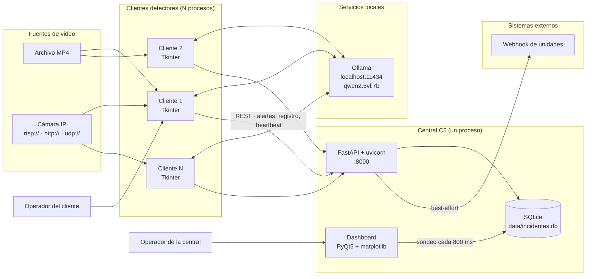

**Claves:**

- Ollama es local a cada cliente o compartido en la red; nunca se llama desde la
  central.
- La central no detecta nada: recibe, prioriza, persiste y muestra.
- El dashboard no habla con la API: lee la misma SQLite que escribe el servidor.
- Si la central cae, los clientes siguen detectando (**fail-open**).

---

## 2. Flujo de extremo a extremo

Resumen visual de las dos etapas y el despacho.

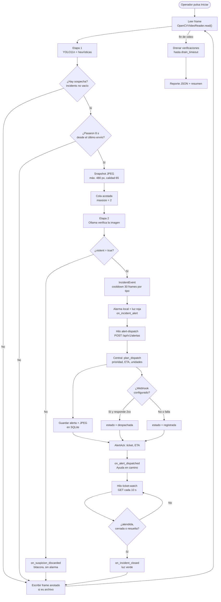

**Nota:** en modo vivo no hay `WRITE` ni `SUMMARY` con archivos; el bucle sigue
hasta `stop()` o hasta que la fuente deja de entregar frames.

---

## 3. Etapa 1: de frame a sospecha

Detalle de `YoloIncidentDetector.analyze()`.

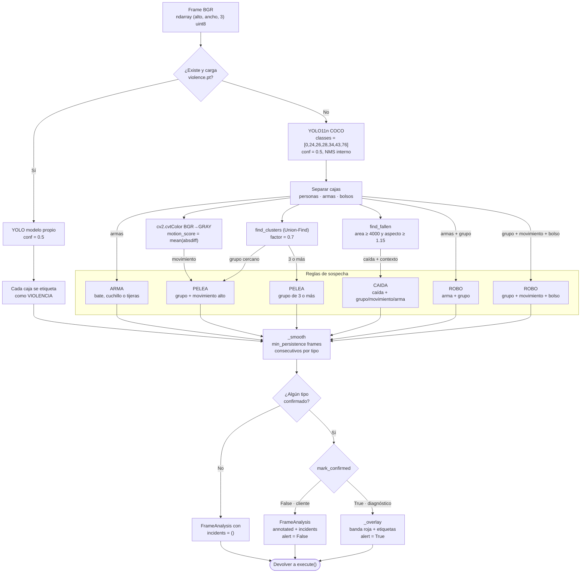

### Valores por defecto relevantes

| Parámetro | Valor | Efecto |
|---|---|---|
| `confidence` | 0.5 | Descarta cajas con menos del 50 %. |
| `motion_threshold` | 12.0 | Media de `absdiff` en 0-255. |
| `proximity_factor` | 0.7 | Distancia entre centros / tamaño medio. |
| `min_persistence` | 6 (cliente: 2) | Frames consecutivos para confirmar. |
| `fall_aspect_ratio` | 1.15 | Caja más ancha que alta. |
| `min_person_area` | 4000 px² | Ignora detecciones diminutas. |

---

## 4. Etapa 2: de sospecha a incidente

Detalle de la cola y el worker de verificación.

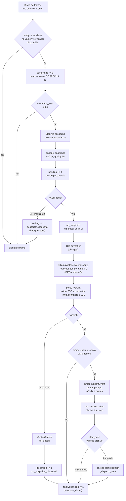

**Invariante de concurrencia:** `pending` se incrementa **antes** de encolar y
se decrementa en `finally`. Así el drenaje nunca ve `pending = 0` mientras hay
un trabajo en vuelo.

---

## 5. Secuencia completa

Orden temporal de una detección confirmada.

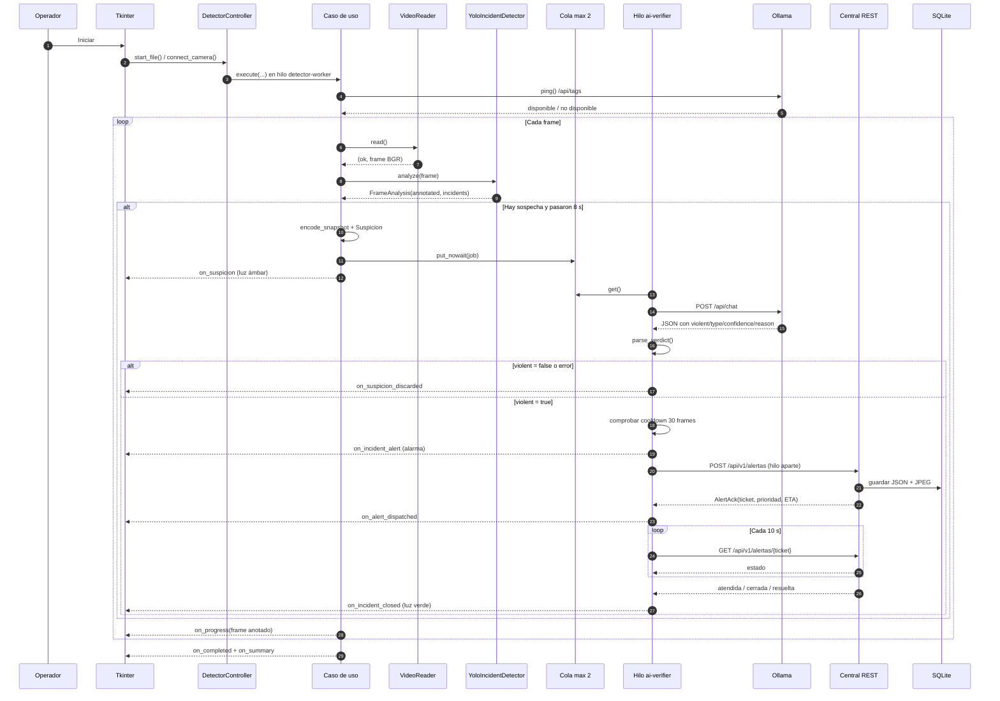

**Aclaración:** el `POST` a la central no lo hace el worker de IA, sino un hilo
`alert-dispatch` que se lanza después del evento. En el diagrama se muestra en
la misma línea temporal para no añadir un participante más, pero son hilos
distintos: el worker sigue verificando mientras la alerta viaja.

---

## 6. Estados de la luz y del ticket

### 6.1 Luz del cliente

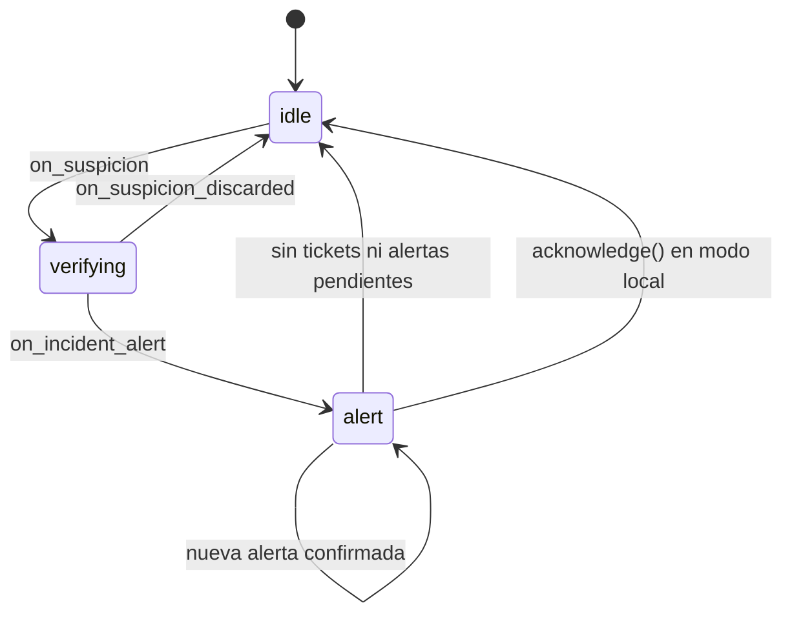

La luz solo vuelve a verde cuando se cumplen las tres condiciones:

- no quedan tickets abiertos (`_open_tickets`),
- no hay alertas esperando respuesta de la central (`_pending_alerts`),
- no hay alertas locales sin ticket (`_local_alerts`).

### 6.2 Ticket en la central

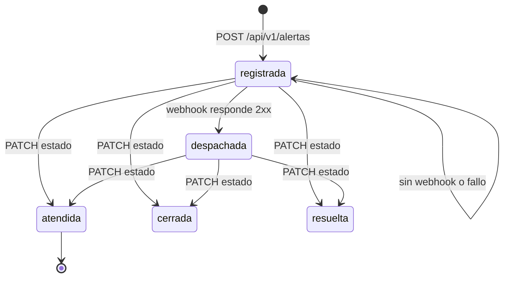

El cliente considera cerrado cualquiera de `atendida`, `cerrada` o `resuelta`
(comparación sin distinguir mayúsculas).

---

## 7. Hilos y responsabilidades

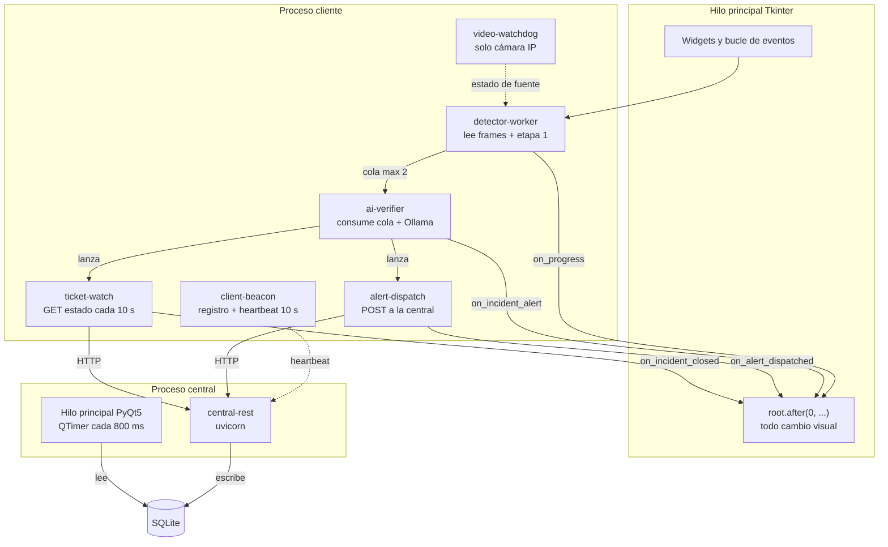

**Regla de oro:** ningún hilo toca widgets directamente. Todo pasa por
`root.after(0, callback)`. En la central, el dashboard nunca hace red desde Qt:
el servidor corre en otro hilo y el dashboard lee la base.

---

## 8. Arranque y cierre

### 8.1 Arranque del cliente

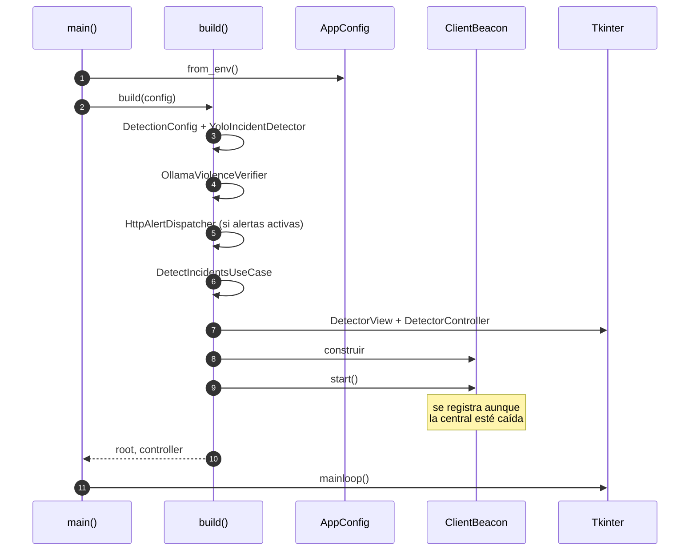

### 8.2 Cierre ordenado

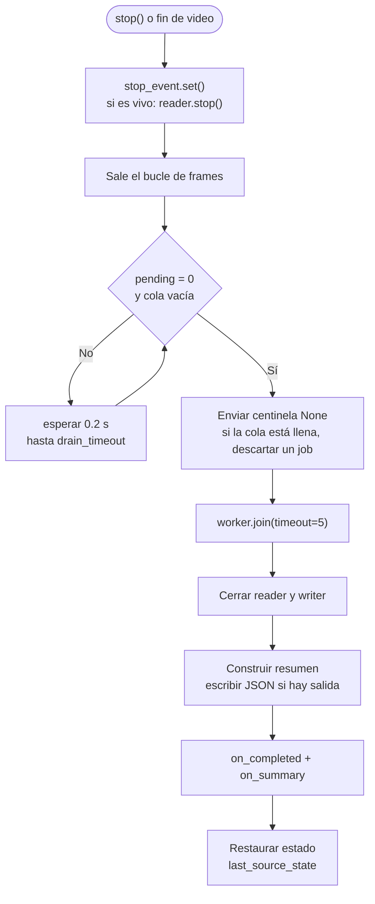

---

## 9. Modo archivo vs modo vivo

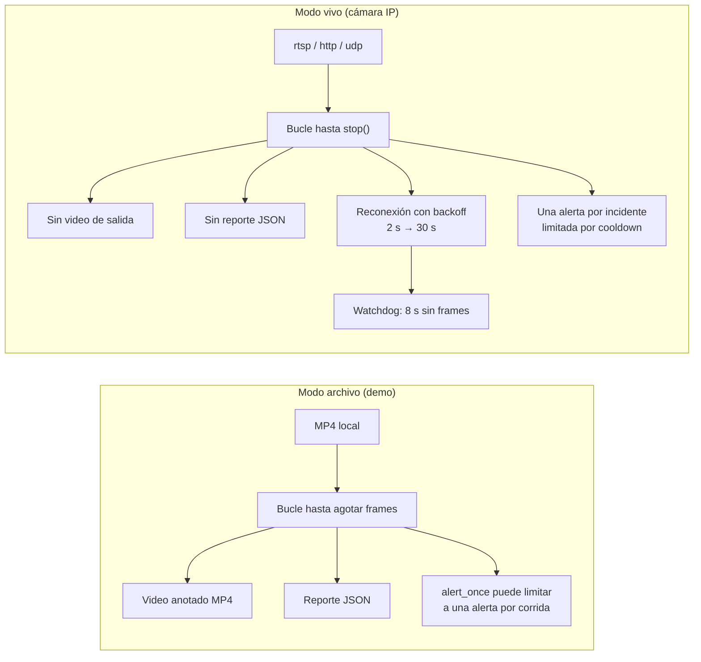

| Aspecto | Archivo | Vivo |
|---|---|---|
| Fuente | MP4 | URL de red |
| Fin | Se agota el video | `stop()` o fuente detenida |
| Video anotado | Sí | No |
| Reporte JSON | Sí | No |
| Tiempo del evento | `frames_read / fps` | Reloj monótono |
| Fallo de fuente | Error y fin | `NO_SIGNAL` + reconexión |
| Alertas | `alert_once` configurable | Una por incidente con cooldown |

---

## 10. Cadena de llamadas en el código

Para seguir el hilo con el editor abierto.

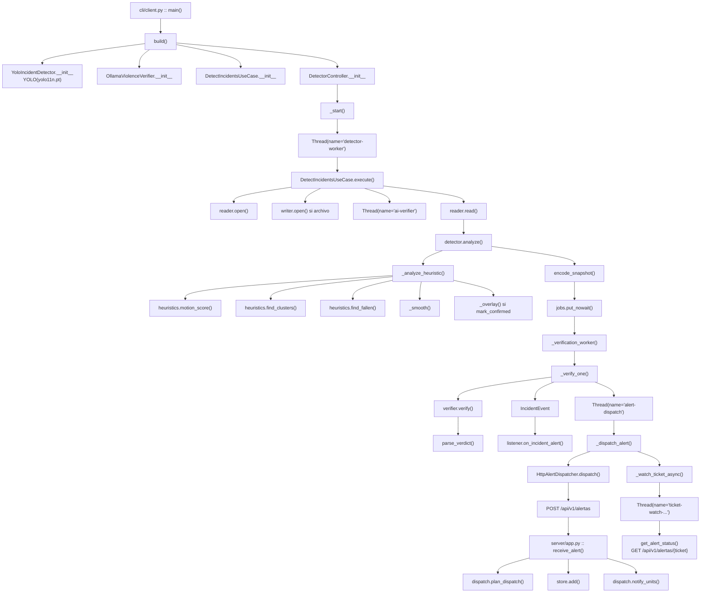

---

## Leyenda rápida

| Símbolo / color | Significado |
|---|---|
| Rectángulo | Proceso, función o paso. |
| Rombo | Decisión. |
| Cilindro | Base de datos. |
| Flecha sólida | Flujo o llamada. |
| Flecha discontinua | Señal periódica o best-effort. |
| `fail-closed` | Ante duda, no alertar (Ollama). |
| `fail-open` | Ante fallo, seguir funcionando (central). |

## Los tres invariantes que resume el dibujo

1. **YOLO propone, la IA confirma, la central despacha.**
2. **La etapa 2 nunca bloquea a la etapa 1:** cola acotada + worker + descarte.
3. **La caída de la central no detiene la detección:** fail-open; la caída de
   Ollama no genera alarmas: fail-closed.
